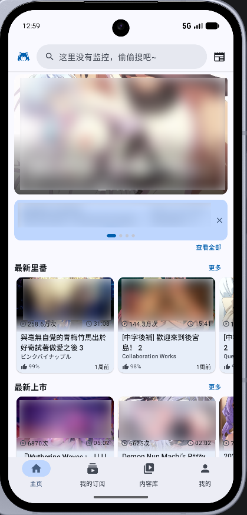
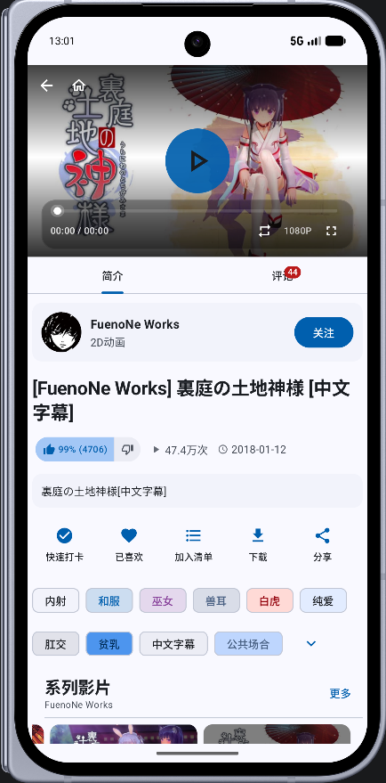
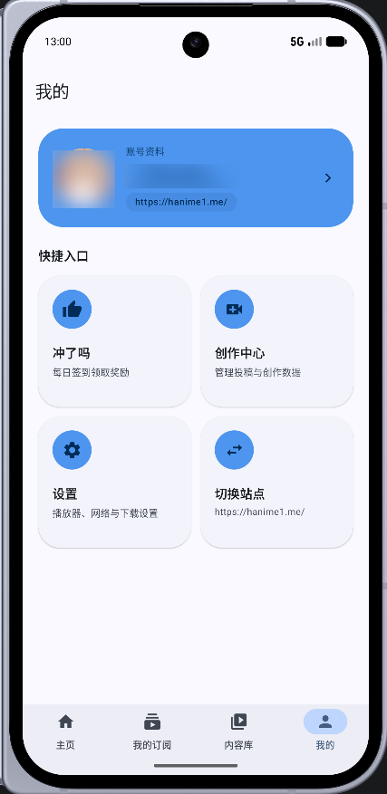
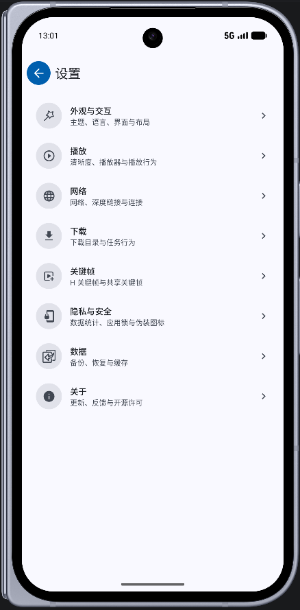
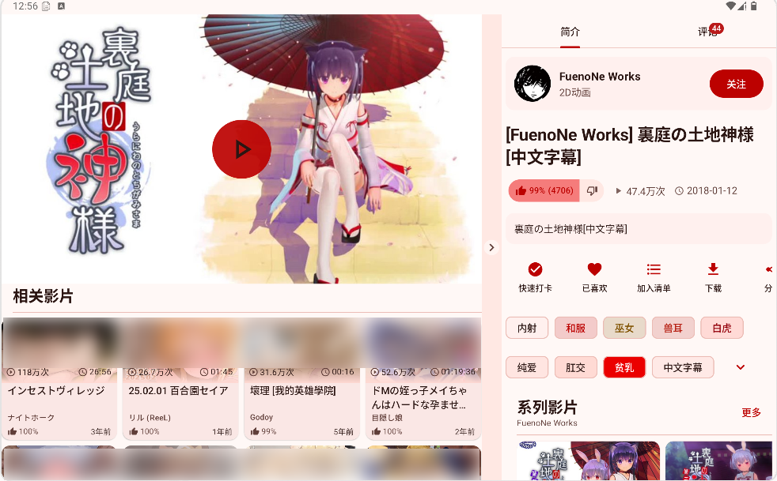
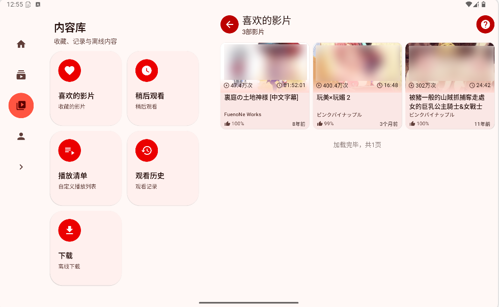
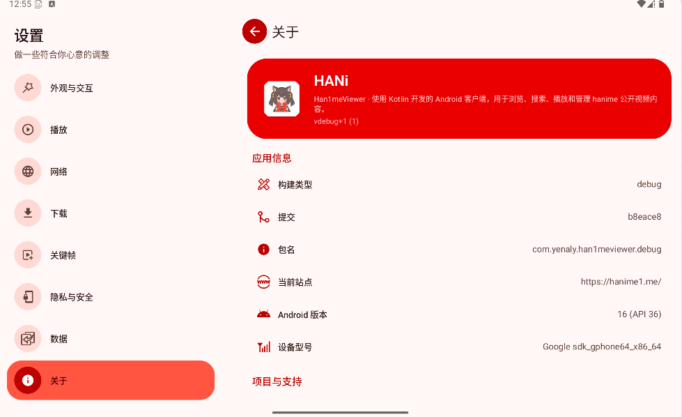

[简体中文](README.md) | **English**

# HANiEX

Hanime1 · Javchu · MissAV · HentaiMama · OnAir · FapFolder · SupJav · RouVideo · XHamster · Buondua

[Tor VPN](https://play.google.com/store/apps/details?id=org.torproject.android) is required for the OnAir site (see "Supported Sites").

<table>
  <tr>
    <td></td>
    <td></td>
    <td></td>
  </tr>
  <tr>
    <td></td>
    <td></td>
    <td></td>
  </tr>
  <tr>
    <td></td>
    <td></td>
    <td></td>
  </tr>
</table>

# 🚫 Please do not promote this app on any public platform

This app does not accept any form of public promotion. If public promotion, re-posting or traffic diversion is found, the repository maintainers may archive or hide the repository at any time and delete compiled releases.

# 🌸 HANiEX

🔞 R18 warning: downloading and using this app is prohibited for anyone under 18.

HANiEX (Han1meViewer Extended) is an extended fork of Han1meViewer. The app is named **HANiEX** and its application ID (applicationId) is `com.yenaly.hani.extended`. It is an Android client written in Kotlin for browsing, searching, playing and managing publicly available video and image pages. Besides the original Hanime1 support it now bundles **ten site modules** (see "Supported Sites") behind one app shell: a site switcher, per-site home/search/video/history screens, per-site mirror and network settings, cross-site link opening, unified history and local playlists. The project is built mainly on Jetpack Compose, Navigation Compose, ViewModel, StateFlow, Retrofit, Jsoup, Room, WorkManager and Media3 ExoPlayer / libmpv (both used through a Compose player).

This app has no official website. The GitHub Releases and CI build artifacts of this fork, [lwprfs/HANiEX](https://github.com/lwprfs/HANiEX), are the only download and update channels.

## 📜 Origin and License

This project was originally forked from [YenalyLiew/Han1meViewer](https://github.com/YenalyLiew/Han1meViewer). The current direct upstream is [misaka10032w/Han1meViewer](https://github.com/misaka10032w/Han1meViewer), and this fork is [lwprfs/HANiEX](https://github.com/lwprfs/HANiEX). Thanks to all the authors for their contributions. The original project uses the [Apache License 2.0](https://www.apache.org/licenses/LICENSE-2.0).

Main changes in this fork compared with upstream:

- The app was renamed to HANiEX and its application ID changed to `com.yenaly.hani.extended` (the Kotlin source `namespace` is still `com.yenaly.han1meviewer`).
- Multi-site support: MissAV, HentaiMama, Javchu, OnAir, FapFolder, SupJav, RouVideo, XHamster and Buondua were added next to Hanime1, together with a site switcher, per-site mirrors, cross-site opening, unified history, local playlists and backup/restore.
- In-app updates now come from this fork's Releases / CI, and incremental (delta) updates were added.
- The update package can be installed with the system installer or silently through Shizuku, switchable in settings.
- CI gained Gradle caching and build optimizations, and generates delta update packages during the build (against up to three previous CI builds and the latest release).
- The Shizuku implementation is based on the extension installer of [Mihon](https://github.com/mihonapp/mihon) (Apache 2.0 / MIT).

As required by the Apache 2.0 license:

- Keep the original copyright notices.
- Include a copy of the license file.
- State the changes that were made.

Original repository: [YenalyLiew/Han1meViewer](https://github.com/YenalyLiew/Han1meViewer)

License file: [LICENSE](LICENSE)

## ⚠️ Disclaimer

This application has no affiliation, cooperation or authorization relationship with `https://hanime1.me/` or with any other website it can browse (see "Supported Sites"), or with their related parties.

🔍 Data sources:

- The app only obtains information publicly displayed on the target websites through ordinary network requests and HTML DOM parsing.
- The app does not access the website's backend database.
- The app does not perform injection attacks, bypass authorization or obtain non-public user private data.

⚖️ Usage restrictions:

- This app is for technical research, learning and mobile experience optimization only.
- This app does not provide any commercial service.
- Users must comply with the laws and regulations of their region and the rules of the target websites.

©️ Copyright:

- The copyright of the original videos, images, text and related content belongs to the respective websites or the original producers and distributors.
- This app does not store copyrighted content, does not modify the original content, and does not claim ownership of any content.

🛡️ Liability exemption:

- This app does not guarantee the completeness, accuracy or timeliness of data.
- Users bear all consequences arising from the use of this app.
- This app must not be used for any illegal purpose.

If any of the websites considers the behavior of this app inappropriate, it can contact the maintainers through the built-in features of the GitHub repository.

🔄 Last updated: `2026-11-15`

ℹ️ You are encouraged to support the original site's content through official channels and to click ads to support the site operators.

## 💬 Discussion

Telegram group: [https://t.me/Han1meViewer](https://t.me/Han1meViewer)

## 🌐 Supported Sites

The site is chosen in the site switcher (drawer / site dialog) and the whole UI follows it. Each site is a self-contained package under `app/src/main/java/com/yenaly/han1meviewer/<Site>/` with its own network client, parser, Room database (history), navigation graph and screens. Sites you do not use can be hidden in Settings (site visibility).

| Site | Type | What the module provides |
| --- | --- | --- |
| Hanime1 (`HANIME`) | Anime video | The original, most complete module: home, search, advanced search, video detail, comments, login, favorites, watch later, playlists, subscriptions, creator center, downloads, preview pages, shared key H frames, announcements. |
| Javchu (`JAVCHU`) | JAV library | Shares the Hanime1 module and navigation (treated as the same "site family"), with its own base URL. |
| MissAV (`MISSAV`) | JAV streaming | Home, search, video playback, history, account / login, Cloudflare handling. |
| HentaiMama (`HENTAIMAMA`) | Anime streaming | Home, recent, upcoming, series, playlists, search, history, video playback. |
| OnAir (`ONAIR`) | Self-hosted onion video site | Home, search, tags, pictures, video, history, account/auth, chat, announcements, mirror status. **Requires a Tor exit**; the app checks this before switching to it. |
| FapFolder (`FAPFOLDER`) | Community feed (albums and videos) | Home feed, posts, albums, groups, hashtags, profiles, followed, saved, search, history, login. |
| SupJav (`SUPJAV`) | JAV streaming | Home, search, video (stream resolver), history, site settings. |
| RouVideo (`ROUVIDEO`) | Video | Home, categories, library, search, video, history, account / login, site settings. |
| XHamster (`XHAMSTER`) | Video and galleries | Home, categories, discover, entities, galleries, library, profile / account, search, video, history. |
| Buondua (`BUONDUA`) | Image albums | Home, search, album viewer, history, image downloads. |

Available features differ by site. The list above comes from the source tree and is not a promise that every function works on every mirror.

## ✨ Features

🧩 Across all sites:

- 🔀 Site switching: site drawer and switch dialog, per-site visibility, the last used site is remembered, a usage notice dialog on first launch.
- 🔗 Cross-site opening: a shared link or clipboard link can open a video on another site (`CrossSiteNavigator`, with a reachability / Tor check before switching).
- 🪞 Mirrors and network: per-site mirror lists with built-in catalog, mirror latency test, custom mirror host, DNS-over-HTTPS presets, proxy settings, Cloudflare verification, built-in Cloudflare IP list for fronted sites.
- 🕘 History: per-site history databases plus a unified history screen; search history per site.
- 📚 Library: local playlists across sites and a content library entry.
- 💾 Backup and restore: export / import settings, check-in records, key frames, per-site history, downloads and (optionally) per-site cookies, chosen section by section.
- 🌍 Languages: Simplified Chinese, English and Japanese, switchable in-app; tag / title / description / comment translation cache and Simplified-to-Traditional conversion.
- ▶️ Playback: Media3 ExoPlayer and libmpv kernels behind one Compose player, Anime4K super-resolution (MPV), picture-in-picture, playback speed and quality selection, gesture controls, resume from history.
- 📥 Downloads: WorkManager background downloads (including HLS), download groups (auto-created by series name), importing local files, custom download directory (SAF), playback after download, per-site image saving and download-failure classification (Tor / cookies / network / storage / expired).
- 🎨 Theme and settings: Material 3, dynamic color, home layout, grid columns, card size, settings split into Appearance / Playback / Network / Download / Keyframes / Privacy / Data / About.
- 🕵️ Privacy: app lock (biometric), launcher icon disguise (calculator / Cornhub / "Xxt" aliases), manual cookie management.
- 🔄 In-app updates: Release / CI channels, delta (patch) updates with automatic fallback to the full APK, install with the system installer or Shizuku. See "App Updates" and "Install Methods".
- 📅 Health check-in: check-in page, calendar and a home screen widget (per-site check-in records).
- 🎯 Shared key H frames: built-in key frame data, settings and shared data display.

🅷 Hanime1-specific: login with manual cookie entry, avatar cropping, favorites, watch later, playlists, online history, subscriptions, creator center, comments (sorting, replies, reporting), preview pages, search with advanced filters, announcements.

## 🗞️ Announcement System Guide

The announcement system has two parts:

- User side: the Hanime1 home page (`HomePageViewModel`) reads the `announcements` node from Firebase Realtime Database. The home page shows valid announcements and lets users open an announcement detail dialog (`ui/screen/home/homepage/component/Announcement*.kt`). OnAir has its own announcement screen.
- Maintenance side: `HanimeAnnouncementManagerWebUI` maintains the announcement data. It writes, updates or takes down announcements on the same `announcements` node.

The `HanimeAnnouncementManagerWebUI` directory contains two files:

- `HanimeAnnouncementManager.html`: the announcement management web page, used to add, delete, edit and query announcements and to toggle their enabled state.
- `PermitAdmin.py`: writes the `isAdmin` custom claim to Firebase Auth users, which controls who can access the admin page.

Prerequisites:

- The app must be able to access the network normally.
- The Firebase Realtime Database address configured in the project must be available.
- The announcement data under the `announcements` node must match the `Announcement` model, containing at least fields such as `title`, `content` and `isActive`.
- Announcements are sorted by `priority` in ascending order (a smaller value is shown first), and only announcements with `isActive = true` are shown.
- The admin side needs Firebase Authentication and Realtime Database enabled.
- The admin side needs the Firebase web config parameters and an admin email and password that can sign in.
- To use `PermitAdmin.py`, you also need the Firebase Admin SDK `serviceAccountKey.json`.

Usage rules:

- The home page shows the list of valid announcements by default.
- After the user dismisses an announcement, `last_dismiss_time` is recorded, and it will not pop up automatically again within 24 hours.
- Announcement details support a title, content, publish time, image and button text.
- If an announcement has a link configured, the URL can be shown as clickable text in the content.

Admin page steps:

1. Fill in `firebaseConfig` in `HanimeAnnouncementManager.html`.
2. Fill `ADMIN_EMAIL` and `ADMIN_PASSWORD` with an admin account that can sign in to Firebase Auth.
3. Make sure the Realtime Database rules allow that admin account to read and write the `announcements` node.
4. To authorize admins in bulk, install `firebase-admin`, prepare `serviceAccountKey.json`, then run `PermitAdmin.py` and enter the target user UIDs.
5. Open the admin page to add, edit, enable, disable or delete announcements.

Announcement fields:

- `title`: announcement title.
- `content`: announcement body.
- `imageUrl`: announcement image URL, optional.
- `positiveText`: confirm button text, optional.
- `negativeText`: cancel button text, optional.
- `priority`: sort priority.
- `timestamp`: announcement timestamp, in seconds.
- `isActive`: whether it is enabled.

The model is `logic/model/Announcement.kt`; if a field is added, update the model, the WebUI form and the dialog together.

Maintenance tips:

- Preview a new announcement in the WebUI first, then switch it to `isActive = true`.
- Take down expired or no longer needed announcements instead of deleting them, so they can be traced back.
- The app sorts `priority` ascending (smaller first); keep the WebUI convention consistent with that.

## 🔄 App Updates

The app checks for and downloads updates through GitHub, with no need to open the GitHub page. Updates come from this fork, `lwprfs/HANiEX` (see `HA1_GITHUB_URL` / `HA1_GITHUB_API_URL` in `Constants.kt`).

📡 Update channels (Settings → Update):

- **Release channel (default)**: reads GitHub `releases/latest`, compares the version in the tag with the current version, and takes the APK from the release asset ending in `.apk`.
- **CI channel (optional)**: compares the current `COMMIT_SHA` with the latest CI run on `main` and downloads its `app-release-<sha>` build artifact. `HA_GITHUB_TOKEN` is required to download build artifacts; without a token requests are anonymous and have a lower rate limit. The channel can be switched off remotely with the Firebase Remote Config flag `enable_ci_update` (default on).
- The two channels never fall back to each other, and failed checks are not retried automatically: the reason (rate limit, bad token, missing permission, expired artifact, network) is reported and the user retries manually.

📦 Delta (incremental) updates:

- After a CI build, the new APK is diffed with bsdiff against up to **three previous successful CI builds and the latest release APK**. Each patch is uploaded as a separate artifact named `delta-<sha>-base-<first 16 characters of the old APK's SHA-256>`. A patch that is 80% or more of the full APK, or an identical APK, is not published.
- Release channel: on `[release]` builds the APK is diffed against the previous release tag's APK, and the patch is uploaded as the release asset `HANiEX-delta-base-<first 16 characters>.zip`.
- A patch package contains `update.json` (format `bsdiff40`, SHA-256 of the base and new APKs, sizes) and `update.patch`.
- The app computes the SHA-256 of the installed APK and picks the published patch whose base matches it, downloads it, rebuilds the new APK with its own pure Kotlin bspatch (`util/Bspatch.kt`), then verifies size, SHA-256 and signing certificate.
- If anything fails (no patch published, base mismatch, split install, unreadable installed APK, bad metadata, patch or verification failure, signer mismatch), the update screen shows the reason and the app falls back to the full APK.

⚠️ Notes:

- Incremental updates require the installed APK to be exactly the one a patch was built against; users further behind get the full APK.
- The first version that includes incremental updates must be installed manually.
- Because the package name changed (`com.yenaly.han1meviewer` → `com.yenaly.hani.extended`), the system treats HANiEX as a different app. Old installs will not update to HANiEX, so it must be installed fresh.
- Debug builds use a hard-coded `COMMIT_SHA`, so CI-channel comparisons are not meaningful for them, and a cached update file is ignored when `BuildConfig.DEBUG` is set.

## 📲 Install Methods

After the update package is downloaded, it is installed with the "Install method" chosen in settings (Settings → Update → Install method):

| Method | Description |
| --- | --- |
| System installer (default) | Opens the system install screen (`FileProvider` + `ACTION_VIEW`). Needs the "install unknown apps" permission. Best compatibility. |
| Shizuku | Installs silently with shell permission through Shizuku. Shizuku must be installed and running, and permission is requested when you select it. |

- If Shizuku is selected but not installed, not running, denied or the install fails, the app shows the reason and falls back to the system installer.
- The Shizuku side lives in `shizuku/ShizukuUpdateInstaller.kt` and `shizuku/ShellInterface.kt` (AIDL: `src/main/aidl/com/yenaly/han1meviewer/shizuku/IShellInterface.aidl`), which runs in the Shizuku process and submits the install session.
- The Shizuku implementation is based on the extension installer of [Mihon](https://github.com/mihonapp/mihon).

## 📷 Screenshots

<table>
  <tr>
    <td></td>
    <td></td>
  </tr>
  <tr>
    <td></td>
    <td></td>
    <td></td>
  </tr>
  <tr>
    <td></td>
    <td></td>
    <td></td>
  </tr>
</table>

## 🧱 Current Architecture

📦 The project is a Gradle build with a single app module plus build logic:

- `:app`: the only module included in `settings.gradle.kts` (UI, navigation, ViewModels, network parsing, databases, download workers, players, resources, all site modules).
- `buildSrc`: build helper code for version numbers, version source (debug / release / ci) and commit SHA.
- `yenaly_libs/`: a leftover directory of the old common library. It is **not** part of the build (no `build.gradle`, not included in `settings.gradle.kts`, and nothing imports it); it can be removed.

🗂️ The app package (`com.yenaly.han1meviewer`) is organized as follows:

- Site modules, one package per site: `MissAV`, `HentaiMama`, `OnAir`, `FapFolder`, `SupJav`, `RouVideo`, `XHamster`, `Buondua`. Each follows the same layout: `common` (constants, URL utils, settings, image loader), `cloudflare`, `data/{remote,parser,model,local,repository}` (Retrofit service, cookie jar, parser, Room history database) and `ui/{home,search,video,history,navigation,...}`.
- Hanime1 and Javchu live in the shared packages: `logic` (network, parsers, models, DAO, state), `ui` and `worker`.
- `ui.navigation`: `UnifiedMainNavHost` picks the NavHost of the current `SiteType`; `NavigationManager` (switch site, open video, back stack), `CrossSiteNavigator` (open a video on another site, with reachability / Tor validation), `main/` (Hanime routes), `settings/` (settings routes and categories), `site/` (shared site hub routes).
- `ui.screen`: Compose screens split by area (`main` for the scaffold and site drawer, `home`, `search`, `video`, `settings`, `account`, `history`, `library`, `login`, `site`, `web`).
- `ui.component`: reusable components (video cards, dialogs, site chrome, site switch dialog, update dialog, paging and lazy-list wrappers).
- `ui.player`: the Compose player (kernel abstraction, controller, surface, controls).
- `ui.viewmodel`: page state and business actions, exposed through `StateFlow` / `SharedFlow`.
- `logic.network`: Retrofit services, OkHttp interceptors, DNS (`HDns`, DoH presets), `HCookieJar`, proxy selector, per-site profiles (`SiteNetworks`, `SiteMirrorCatalog`, `SiteNetworkPrefs`, `MirrorLatency`), `HUpdater` / `HDeltaUpdater`.
- `logic.update`: `UpdateManager` (update state machine used by the update dialog and status screen).
- `logic.dao` / `logic.entity`: Room databases for history, downloads, key frames, check-ins and misc data; each site module has its own database for its history.
- `logic.BackupManager`, `logic.SiteCheckIn`, `logic.local.LocalPlaylistStore`: cross-site backup, check-in and local playlists.
- `worker`: WorkManager download tasks (`HanimeDownloadManagerV2`, `HanimeDownloadWorker`, `HlsDownloader`) and update tasks (`HUpdateWorker`, `UpdateActionReceiver`).
- `shizuku` (with `src/main/aidl`): silent update install through Shizuku.
- `util`: themes, network, files / SAF, permissions, cookies, translation, site download helpers, `Bspatch` and general helpers.

🔁 Overall data flow:

```text
Compose Screen -> ViewModel -> Repo (NetworkRepo / site Repo / DatabaseRepo) -> Retrofit + Jsoup / Room -> StateFlow -> Compose Screen
```

🔀 Site switching flow:

```text
SiteSwitchDialog / CrossSiteNavigator -> Preferences.siteType + NavigationManager.switchSite -> UnifiedMainNavHost -> <Site>NavHost
```

🎞️ Hanime video page data flow:

```text
VideoRoute -> VideoViewModel -> NetworkRepo.getHanimeVideo -> Parser -> HanimeVideo -> VideoScreen / Player / CommentScreen
```

🔄 Update data flow:

```text
HUpdater checks for updates -> HUpdateWorker / UpdateManager -> (HDeltaUpdater delta rebuild | full APK download) -> installApkPackage -> system installer | Shizuku
```

📥 Download data flow:

```text
DownloadScreen -> DownloadViewModel -> HanimeDownloadManagerV2 -> WorkManager Worker -> Room -> Flow -> UI
```

For more detail see [README_TECH.md](README_TECH.md).

## 🛠️ Tech Stack

Versions follow `gradle/libs.versions.toml` and `app/build.gradle.kts`:

- Kotlin 2.4.x, Java 21 toolchain
- Android Gradle Plugin 9.1.0
- Jetpack Compose (BOM 2026.08.00) + Material 3 (1.5.0-beta02, with adaptive navigation suite)
- Navigation Compose 2.9.x + Kotlin Serialization typed routes
- ViewModel + StateFlow + SharedFlow
- Retrofit 3 + kotlinx.serialization converter, OkHttp 5 (with `okhttp-brotli`, DNS-over-HTTPS)
- Jsoup HTML parsing
- Room 2.8 + KSP
- WorkManager background tasks
- Coil 3 Compose image loading
- Media3 ExoPlayer (+ HLS, OkHttp data source) and libmpv (`mpv-android`) with Anime4K shaders
- Firebase Analytics, Crashlytics, Performance, Remote Config, Realtime Database
- AndroidX Window, Biometric, SplashScreen, Preference, Security Crypto
- Apache Commons Compress (bzip2, used to decompress incremental patches)
- Shizuku API / Provider (silent install)
- AboutLibraries open-source license display, CrashX crash screen

## 🧰 Build Environment

✅ Recommended environment:

- A recent Android Studio that supports AGP 9.1.
- JDK 21.
- The Gradle Wrapper version bundled in the repository.
- Compile SDK: `37`.
- Minimum supported: Android 8.1, API `27`.
- Target SDK: `37`.

⚡ Build optimizations (`gradle.properties`):

- `org.gradle.caching`, `org.gradle.parallel`, `org.gradle.daemon` and `kotlin.incremental` are enabled, and `org.gradle.jvmargs` is `-Xmx3g -XX:MaxMetaspaceSize=1g -Dfile.encoding=UTF-8`.
- `org.gradle.configuration-cache` is not enabled (the build script reads environment variables and runs git commands at configuration time). Enable it only after confirming compatibility.
- `android.suppressUnsupportedCompileSdk=37` is set because compileSdk 37 may be newer than the AGP version officially supports.

📌 Key versions follow the repository files:

- `gradle.properties`
- `gradle/libs.versions.toml`
- `app/build.gradle.kts`
- `buildSrc/src/main/java/Config.kt`

🔢 Versioning: the base version is set in `app/build.gradle.kts` (`createVersion(major, minor, patch)`). Debug builds are `debug+1`. Other builds are `<major>.<minor>.<patch>-<source>+<yyMMddHH>` where the source is `release`, or `ci` when `HA1_VERSION_SOURCE=ci` is set (CI does this); the part after `+` is the version code (UTC time).

## 🚀 Running Locally

1. Clone the project:

   ```bash
   git clone https://github.com/lwprfs/HANiEX.git
   ```

2. Open the project root in Android Studio.

3. Wait for Gradle Sync to finish.

4. Select the `debug` variant and run it on a device or emulator.

💻 Common commands:

```bash
./gradlew :app:compileDebugKotlin
./gradlew :app:assembleDebug
```

🪟 Windows PowerShell:

```powershell
.\gradlew.bat :app:compileDebugKotlin
.\gradlew.bat :app:assembleDebug
```

🔥 Firebase: put `google-services.json` in the `app/` directory (this file is ignored by `.gitignore`, and CI generates it from a secret). It must contain the app that matches the `applicationId`: `com.yenaly.hani.extended` for release. Debug builds add the `.debug` suffix (`com.yenaly.hani.extended.debug`), so you need to add that app in Firebase as well, otherwise the debug build fails because no matching client is found.

🔏 Release builds need signing configuration provided locally or by CI:

- Keystore file: `$HOME/.android/keystore.jks`
- Environment variables: `KEYSTORE_PASSWORD` (also used as the key password) and `KEY_ALIAS`
- Release packages only `arm64-v8a`, with R8 minification and resource shrinking enabled, and the output file is named `HANiEX-v<versionName>.apk`

🔑 The GitHub API token can be provided through an environment variable or a local file:

- Environment variable: `HA_GITHUB_TOKEN`
- Local file: `app/ha1_github_token.txt` (git-ignored)

## 🤖 CI and Releases

Three workflows live in `.github/workflows/`:

| Workflow | Trigger | Purpose |
| --- | --- | --- |
| `ci.yml` | push to `main` (changes that only touch `*.md` are ignored) | Build and sign the release APK, generate delta patches, upload artifacts, optionally publish a release |
| `pr_check.yml` | pull request to `main` (`*.md`-only changes ignored) | Debug build check (`./gradlew buildDebug -x lint`) |
| `debug-apk.yml` | manual (`workflow_dispatch`) | Build an unminified debug APK and upload it as `app-debug-<sha>`, useful for comparing against R8 problems |

`ci.yml` steps:

1. Check out the code (full history), set up JDK 21, and configure Gradle caching with `gradle/actions/setup-gradle@v6`.
2. Generate `google-services.json` and the signing keystore from secrets, then run `./gradlew assembleRelease --build-cache --parallel` with `HA1_VERSION_SOURCE=ci`.
3. Find up to three previous successful CI runs on `main` and download their APK artifacts, download the latest release APK, and generate bsdiff patches against each (duplicated bases are skipped; failures never break the main flow).
4. Upload the build artifacts: `app-release-<sha>` (full APK), `r8-mapping-<sha>` (R8 mapping to de-obfuscate crash logs), and one `delta-<sha>-base-<hash>` artifact per generated patch.
5. When the commit message contains `[release]`, also generate release notes from `git log` since the previous tag, diff against the previous release for a release delta, and create a GitHub Release tagged with the version name (with the APK and the patch zip).

⚡ Cache behavior: the first run downloads dependencies and writes the cache; later runs reuse the cache and reusable build outputs. The cache is only written on the `main` branch. GitHub removes caches that go unused for a long time or exceed the repository size limit, and the first run after that rebuilds the cache.

🔐 Secrets to configure:

- `GOOGLE_SERVICES_JSON_BASE64`: Base64 of `google-services.json`.
- `KEYSTORE_BASE64`, `KEYSTORE_PASSWORD`, `KEY_ALIAS`: the signing keystore, its password and alias.
- `HA_GITHUB_TOKEN`: the token the in-app updater uses to read GitHub build artifacts (written into `BuildConfig`).
- `APP_TOKEN`: the token used to create GitHub Releases.

Incremental patches are produced by `.github/scripts/make-delta.sh` (requires `bsdiff`, `jq`; `MAX_PERCENT` defaults to 80).

## ✅ Code Conventions

- Use Jetpack Compose for UI. The only remaining XML layout is the check-in home screen widget; ViewBinding / DataBinding are not enabled.
- Expose page state through `StateFlow`, and pass events through `SharedFlow` or callbacks.
- Do not access Retrofit services or Room DAOs from Composables.
- When appending to network page lists, deduplicate by a stable business key to avoid Compose `Lazy*` list key conflicts.
- When using stable keys in `LazyColumn`, `LazyVerticalGrid` and `LazyRow`, make sure the data source is unique.
- A new site belongs in its own package following the existing site layout; see the "new site" checklist in [README_TECH.md](README_TECH.md).

## 🗺️ Directory Overview

```text
HANiEX/                          Repository root
├── .github/
│   ├── workflows/               ci.yml, pr_check.yml, debug-apk.yml
│   ├── scripts/make-delta.sh    Generates bsdiff incremental patch packages
│   ├── ISSUE_TEMPLATE/          Bug / feature templates (en, zh-CN, zh-TW)
│   └── PULL_REQUEST_TEMPLATE/   Bug fix, feature, key-frame submission templates
├── app/                         Main Android app (the only Gradle module)
│   ├── src/main/java/.../<Site>/  Site modules: MissAV, HentaiMama, OnAir, FapFolder, SupJav, RouVideo, XHamster, Buondua
│   ├── src/main/java/.../logic    Network, parsing, models, databases, state, backup, update
│   ├── src/main/java/.../ui       Activities, Compose screens, navigation, components, player, ViewModels
│   ├── src/main/java/.../util     Utilities (files, cookies, translation, Bspatch, ...)
│   ├── src/main/java/.../worker   WorkManager download / update tasks
│   ├── src/main/java/.../shizuku  Shizuku update installer
│   ├── src/main/aidl              IShellInterface (Shizuku)
│   ├── src/main/assets            h_keyframes, search options, per-site option JSON, Anime4K shaders
│   └── src/main/res               Resources (values, values-en, values-ja, values-zh-rCN), icons, widget
├── HanimeAnnouncementManagerWebUI/  Announcement admin page and admin-claim script
├── buildSrc/                    Gradle build helper code
├── gradle/libs.versions.toml    Dependency version catalog
├── yenaly_libs/                 Unused leftover of the old common library (not built)
├── README.md                    Project description (Chinese)
├── README-en.md                 Project description (English)
└── README_TECH.md               Technical documentation for maintainers (Chinese)
```

## 🤝 Contributing

- Before submitting code, make sure it passes `:app:compileDebugKotlin`.
- When changing network lists, paging or Compose `Lazy*` lists, check for duplicate key risks.
- When changing playback, download, account, cookie, Cloudflare or update logic, please describe how you verified it.
- When changing update or install logic, also check the Release channel, the CI channel, the incremental update fallback and both install methods (system installer and Shizuku).
- When changing a site module, test on that site only after switching to it, and check its mirror / Cloudflare handling.
- Use the issue and pull request templates under `.github/`. To submit shared key H frames, see `.github/PULL_REQUEST_TEMPLATE/submit_h_keyframe.md`.

## 🧩 TODO

- Write ideas down whenever they come up.

## 📄 License

This project inherits the original project's [Apache License 2.0](https://www.apache.org/licenses/LICENSE-2.0). The main terms include:

- Commercial use, modification and distribution are allowed.
- The copyright notice and the license file must be retained.
- A description of modifications must be provided.
- No warranty of quality is provided.
- No liability is accepted for the user's use.

See the [LICENSE](LICENSE) file in the project root for the full terms.
