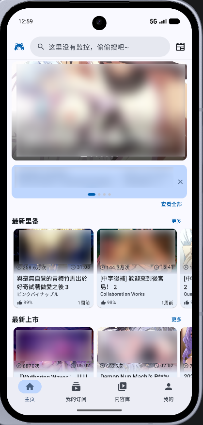
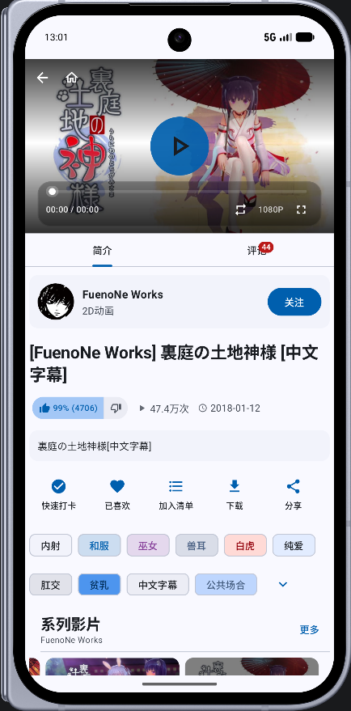
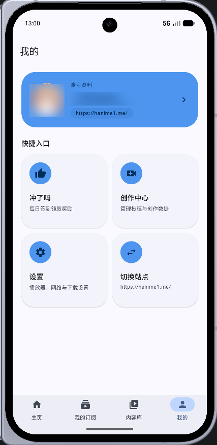
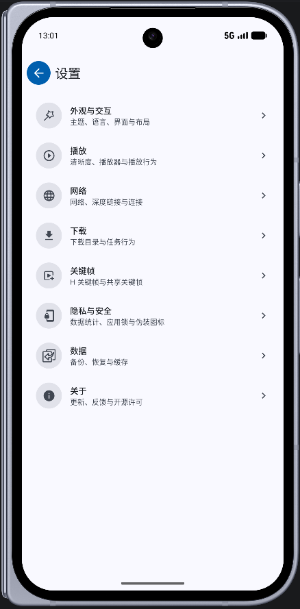
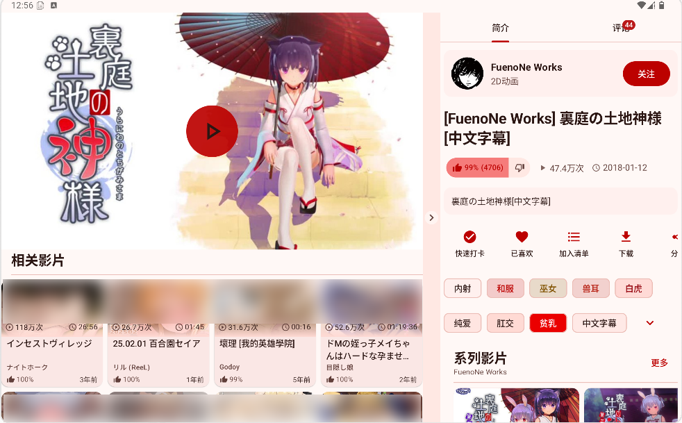
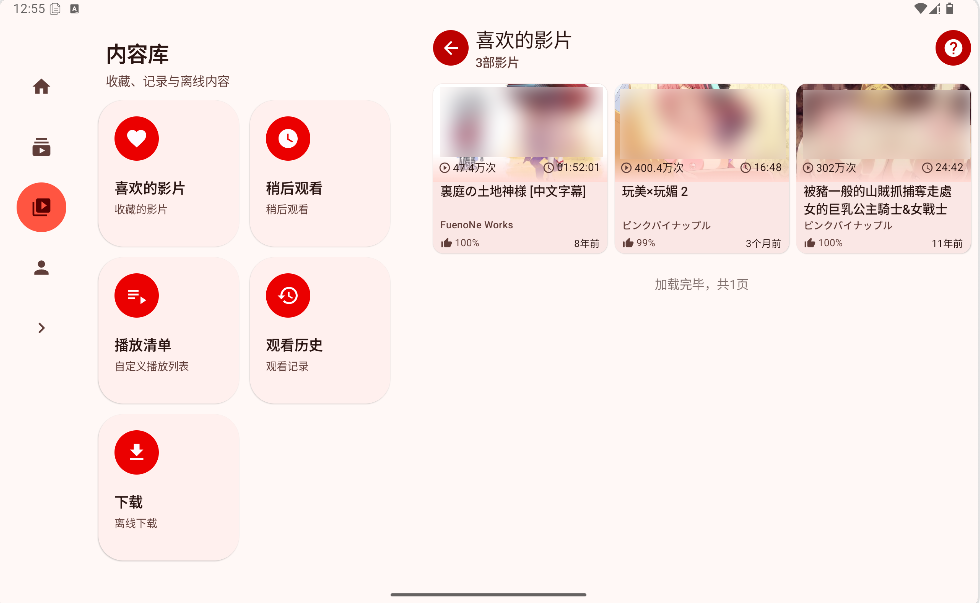
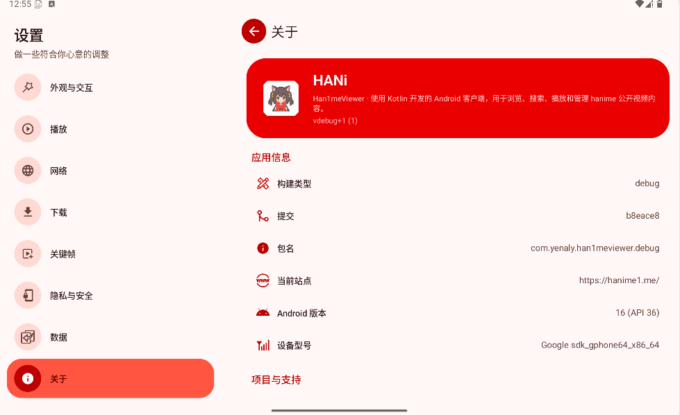

**简体中文** | [English](README-en.md)

# HANiEX

Hanime1 · Javchu · MissAV · HentaiMama · OnAir · FapFolder · SupJav · RouVideo · XHamster · Buondua

OnAir 站点需要 [Tor VPN](https://play.google.com/store/apps/details?id=org.torproject.android)（见「支持的站点」）。

<table>
  <tr>
    <td></td>
    <td></td>
    <td></td>
  </tr>
  <tr>
    <td></td>
    <td></td>
    <td></td>
  </tr>
  <tr>
    <td></td>
    <td></td>
    <td></td>
  </tr>
</table>

# 🚫 请不要在任何公开平台宣传本软件

本软件不接受任何形式的公开宣传。若出现公开宣传、搬运或引流，仓库维护者可能随时归档或隐藏仓库，并删除已编译的发行版。

# 🌸 HANiEX

🔞 R18 警告：未满 18 岁禁止下载和使用。

HANiEX（Han1meViewer Extended）是基于 Han1meViewer 的扩展分支，应用名称为 **HANiEX**，应用包名（applicationId）为 `com.yenaly.hani.extended`。它是一个使用 Kotlin 开发的 Android 客户端，用于浏览、搜索、播放和管理公开的视频与图集页面内容。除原有的 Hanime1 外，现在内置 **十个站点模块**（见「支持的站点」），共用同一个应用外壳：站点切换器、各站点独立的首页/搜索/视频/历史页面、按站点配置的镜像与网络设置、跨站点链接打开、统一历史记录和本地播放列表。当前项目以 Jetpack Compose、Navigation Compose、ViewModel、StateFlow、Retrofit、Jsoup、Room、WorkManager、Media3 ExoPlayer / libmpv（通过 Compose 播放器统一使用）为主要技术栈。

本应用没有任何官方网站。本分支仓库 [lwprfs/HANiEX](https://github.com/lwprfs/HANiEX) 的 GitHub Release 与 CI 构建产物是唯一下载及更新渠道。

## 📜 项目来源与许可

此项目最初 Fork 自 [YenalyLiew/Han1meViewer](https://github.com/YenalyLiew/Han1meViewer)，当前直接上游为 [misaka10032w/Han1meViewer](https://github.com/misaka10032w/Han1meViewer)，本分支为 [lwprfs/HANiEX](https://github.com/lwprfs/HANiEX)。感谢各位作者的贡献。原项目采用 [Apache License 2.0](https://www.apache.org/licenses/LICENSE-2.0)。

本分支相对上游的主要修改：

- 应用改名为 HANiEX，包名改为 `com.yenaly.hani.extended`（Kotlin 源码的 `namespace` 仍为 `com.yenaly.han1meviewer`）。
- 多站点支持：在 Hanime1 之外新增 MissAV、HentaiMama、Javchu、OnAir、FapFolder、SupJav、RouVideo、XHamster、Buondua，并配套站点切换器、按站点镜像、跨站点打开、统一历史、本地播放列表和备份/恢复。
- 应用内更新改为从本分支的 Release / CI 获取，并新增增量（差分）更新。
- 更新包可使用系统安装器或通过 Shizuku 静默安装，可在设置中切换。
- CI 增加 Gradle 缓存与构建优化，并在构建时生成增量更新包（对比最近三次 CI 构建和最新 Release）。
- 安装方式中的 Shizuku 实现参考了 [Mihon](https://github.com/mihonapp/mihon) 的扩展安装器（Apache 2.0 / MIT）。

根据 Apache 2.0 许可证要求：

- 保留原版权声明。
- 包含许可证文件副本。
- 说明修改内容。

原始仓库：[YenalyLiew/Han1meViewer](https://github.com/YenalyLiew/Han1meViewer)

许可证文件：[LICENSE](LICENSE)

## ⚠️ 免责声明

本应用程序与 `https://hanime1.me/` 以及本应用可浏览的其他任何网站（见「支持的站点」）及其关联方均无任何隶属、合作或授权关系。

🔍 数据来源：

- 本应用仅通过常规网络请求和 HTML DOM 解析获取目标网站公开显示的信息。
- 本应用不访问网站后端数据库。
- 本应用不进行注入攻击、绕过授权或获取非公开用户隐私数据。

⚖️ 使用限制：

- 本应用仅用于技术研究、学习交流和移动端体验优化。
- 本应用不提供商业化服务。
- 使用者应自行遵守所在地区法律法规和各目标网站规则。

©️ 版权归属：

- 原始视频、图文和相关内容版权归各对应网站或原始制作、发行方所有。
- 本应用不存储版权内容，不修改原始内容，不声称拥有内容所有权。

🛡️ 责任豁免：

- 本应用不保证数据完整性、准确性和实时性。
- 使用本应用产生的一切后果由用户自行承担。
- 不得将本应用用于任何非法用途。

若任一目标网站认为本应用行为不当，可通过 GitHub 仓库内置功能联系维护者。

🔄 最后更新日期：`2026-11-15`

ℹ️ 建议通过官方渠道支持原站内容，并点击广告以支持网站运营者。

## 💬 参与讨论

Telegram 群组：[https://t.me/Han1meViewer](https://t.me/Han1meViewer)

## 🌐 支持的站点

站点在站点切换器（侧栏 / 切换对话框）中选择，整个界面随之切换。每个站点是 `app/src/main/java/com/yenaly/han1meviewer/<站点>/` 下独立的包，拥有自己的网络客户端、解析器、Room 数据库（历史记录）、导航图和页面。不使用的站点可在设置中隐藏（站点可见性）。

| 站点 | 类型 | 模块提供的内容 |
| --- | --- | --- |
| Hanime1（`HANIME`） | 动画视频 | 原始且功能最完整的模块：首页、搜索、高级搜索、视频详情、评论、登录、收藏、稍后观看、播放列表、订阅、创作中心、下载、预览页、共享关键 H 帧、公告。 |
| Javchu（`JAVCHU`） | JAV 资源库 | 与 Hanime1 共用模块和导航（视为同一「站点家族」），使用独立的基础域名。 |
| MissAV（`MISSAV`） | JAV 流媒体 | 首页、搜索、视频播放、历史、账号 / 登录、Cloudflare 处理。 |
| HentaiMama（`HENTAIMAMA`） | 动画流媒体 | 首页、最新、即将上线、系列、播放列表、搜索、历史、视频播放。 |
| OnAir（`ONAIR`） | 自建 onion 视频站 | 首页、搜索、标签、图片、视频、历史、账号认证、聊天、公告、镜像状态。**需要 Tor 出口**，切换前应用会先检测。 |
| FapFolder（`FAPFOLDER`） | 社区信息流（图集与视频） | 首页信息流、帖子、图集、小组、话题标签、个人主页、关注、收藏、搜索、历史、登录。 |
| SupJav（`SUPJAV`） | JAV 流媒体 | 首页、搜索、视频（含播放源解析）、历史、站点设置。 |
| RouVideo（`ROUVIDEO`） | 视频 | 首页、分类、资料库、搜索、视频、历史、账号 / 登录、站点设置。 |
| XHamster（`XHAMSTER`） | 视频与图库 | 首页、分类、发现、实体页、图库、资料库、个人主页 / 账号、搜索、视频、历史。 |
| Buondua（`BUONDUA`） | 图集 | 首页、搜索、图集查看、历史、图片下载。 |

各站点可用功能并不相同。上表依据源码目录整理，不代表每个功能在每个镜像上都可用。

## ✨ 功能概览

🧩 所有站点通用：

- 🔀 站点切换：站点侧栏与切换对话框、按站点显示 / 隐藏、记住上次使用的站点、首次启动的使用须知对话框。
- 🔗 跨站点打开：分享链接或剪贴板链接可在另一个站点中打开视频（`CrossSiteNavigator`，切换前会做可达性 / Tor 检查）。
- 🪞 镜像与网络：按站点的镜像列表（内置目录）、镜像延迟测试、自定义镜像域名、DNS-over-HTTPS 预设、代理设置、Cloudflare 验证，以及套用 Cloudflare 的站点所用的内置 IP 列表。
- 🕘 历史记录：各站点独立的历史数据库，外加统一历史页面；各站点独立的搜索历史。
- 📚 资料库：跨站点的本地播放列表和内容库入口。
- 💾 备份与恢复：按分区导出 / 导入设置、打卡记录、关键帧、各站点历史、下载记录，以及（可选）各站点 Cookie。
- 🌍 语言：简体中文、English、日本語，可在应用内切换；支持标签 / 标题 / 简介 / 评论的翻译缓存和简繁转换。
- ▶️ 播放：Media3 ExoPlayer 与 libmpv 两种内核共用一个 Compose 播放器，支持 Anime4K 超分（MPV）、画中画、倍速和画质选择、手势控制、历史进度恢复。
- 📥 下载：WorkManager 后台下载（含 HLS）、下载分组（可按系列名自动创建）、导入本地文件、自定义下载目录（SAF）、下载后播放、各站点图片保存，以及下载失败分类（Tor / Cookie / 网络 / 存储 / 过期）。
- 🎨 主题与设置：Material 3、动态颜色、首页布局、网格列数、卡片尺寸，设置分为外观 / 播放 / 网络 / 下载 / 关键帧 / 隐私 / 数据 / 关于。
- 🕵️ 隐私保护：应用锁（生物识别）、启动器图标伪装（计算器 / Cornhub / “Xxt” 别名）、手动 Cookie 管理。
- 🔄 应用内更新：Release / CI 两个渠道，支持增量（差分）更新并在失败时自动回退到完整 APK，可用系统安装器或 Shizuku 安装。详见「应用更新」「安装方式」。
- 📅 健康打卡：打卡页面、日历和桌面小组件（按站点记录打卡）。
- 🎯 共享关键 H 帧：内置关键帧数据读取、设置和共享数据展示。

🅷 Hanime1 专属：登录与手动录入 Cookie、头像裁剪、收藏、稍后观看、播放列表、在线历史、订阅作者、创作中心、评论（排序、回复、举报）、预览页、高级搜索、公告。

## 🗞️ 公告系统使用须知

公告系统分为两部分：

- 用户侧：Hanime1 首页（`HomePageViewModel`）从 Firebase Realtime Database 读取 `announcements` 节点，首页会展示有效公告，并可点开公告详情弹窗（`ui/screen/home/homepage/component/Announcement*.kt`）。OnAir 有自己的公告页面。
- 维护侧：`HanimeAnnouncementManagerWebUI` 用于维护公告数据，负责向同一个 `announcements` 节点写入、更新或下线公告。

`HanimeAnnouncementManagerWebUI` 目录包含两个文件：

- `HanimeAnnouncementManager.html`：公告管理网页，用于增删改查公告、切换启用状态。
- `PermitAdmin.py`：给 Firebase Auth 用户写入 `isAdmin` 自定义声明，用于控制谁能访问管理端。

前置条件：

- 应用必须能够正常访问网络。
- 项目中配置的 Firebase Realtime Database 地址必须可用。
- `announcements` 节点下的公告数据结构需要和 `Announcement` 模型一致，至少包含 `title`、`content`、`isActive` 等字段。
- 公告按 `priority` 升序排序（数值小的在前），只有 `isActive = true` 的公告才会显示。
- 管理端需要启用 Firebase Authentication 和 Realtime Database。
- 管理端需要准备 Firebase Web 配置参数和可登录的管理员邮箱、密码。
- 若使用 `PermitAdmin.py`，还需要 Firebase Admin SDK 的 `serviceAccountKey.json`。

使用规则：

- 首页公告默认会展示为有效公告列表。
- 用户关闭公告后，会记录 `last_dismiss_time`，24 小时内不会再次自动弹出。
- 公告详情支持标题、内容、发布时间、图片和按钮文案。
- 若公告配置了链接，内容中可直接展示可点击的 URL。

管理端使用步骤：

1. 在 `HanimeAnnouncementManager.html` 中填写 `firebaseConfig`。
2. 在 `ADMIN_EMAIL` 和 `ADMIN_PASSWORD` 中填入可登录 Firebase Auth 的管理员账号。
3. 确保 Realtime Database 规则允许该管理员账号读写 `announcements` 节点。
4. 如需批量授权管理员，先安装 `firebase-admin`，准备 `serviceAccountKey.json`，再运行 `PermitAdmin.py` 并填写目标用户 UID。
5. 打开管理页后即可新增、编辑、启用、停用或删除公告。

公告字段说明：

- `title`：公告标题。
- `content`：公告正文。
- `imageUrl`：公告图片地址，可选。
- `positiveText`：确认按钮文案，可选。
- `negativeText`：取消按钮文案，可选。
- `priority`：排序优先级。
- `timestamp`：公告时间戳，单位为秒。
- `isActive`：是否启用。

数据模型为 `logic/model/Announcement.kt`；新增字段时，需同步更新模型、WebUI 表单和公告弹窗。

维护建议：

- 新公告建议先在 WebUI 中预览，再切换为 `isActive = true`。
- 过期或不再需要显示的公告应直接下线，而不是删除，以便回溯。
- 应用按 `priority` 升序（数值小的在前）排序，请让 WebUI 的约定与之保持一致。

## 🔄 应用更新

应用通过 GitHub 检查并下载更新，无需打开 GitHub 页面。更新源是本分支 `lwprfs/HANiEX`（见 `Constants.kt` 中的 `HA1_GITHUB_URL` / `HA1_GITHUB_API_URL`）。

📡 更新渠道（设置 → 更新）：

- **Release 渠道（默认）**：读取 GitHub `releases/latest`，比较 tag 中的版本与当前版本，并从以 `.apk` 结尾的 Release 资源下载安装包。
- **CI 渠道（可选）**：把当前 `COMMIT_SHA` 与 `main` 上最新的 CI 运行比较，下载其 `app-release-<sha>` 构建产物。下载构建产物需要 `HA_GITHUB_TOKEN`；没有 token 时会以匿名方式请求，速率限制更低。该渠道可通过 Firebase Remote Config 开关 `enable_ci_update`（默认开启）远程下线。
- 两个渠道之间不会互相回落，检查失败也不会自动重试：应用会如实报告原因（限额耗尽、密钥失效、权限不足、产物过期、网络异常），由用户手动重试。

📦 增量更新：

- CI 构建完成后，会用 bsdiff 把新 APK 与 **最近最多三次成功的 CI 构建以及最新 Release 的 APK** 分别做差分。每个补丁作为单独的构建产物上传，命名为 `delta-<sha>-base-<旧 APK SHA-256 前 16 位>`。补丁大小达到完整 APK 的 80% 及以上，或 APK 完全相同，则不发布。
- Release 渠道：带 `[release]` 的构建会与上一个 Release tag 的 APK 做差分，补丁作为 Release 资源 `HANiEX-delta-base-<前 16 位>.zip` 上传。
- 补丁包包含 `update.json`（格式 `bsdiff40`、基础与新 APK 的 SHA-256、大小）和 `update.patch`。
- 应用先计算已安装 APK 的 SHA-256，选出基础匹配的补丁并下载，再用自带的纯 Kotlin bspatch（`util/Bspatch.kt`）在本地还原新 APK，最后校验大小、SHA-256 和签名证书。
- 任一步骤失败（没有发布补丁、基础不匹配、分包安装、无法读取已安装 APK、元数据异常、补丁或校验失败、签名不一致），更新页会显示原因，并自动回退为下载完整 APK。

⚠️ 注意事项：

- 增量更新要求已安装 APK 与补丁基础完全一致；落后更多版本的用户会下载完整 APK。
- 第一个包含增量更新功能的版本必须手动安装。
- 由于包名已变更（`com.yenaly.han1meviewer` → `com.yenaly.hani.extended`），系统会把 HANiEX 视为另一个应用。旧版不会更新为 HANiEX，需要重新安装。
- Debug 构建使用写死的 `COMMIT_SHA`，因此 CI 渠道的比较对它没有意义；`BuildConfig.DEBUG` 时也会忽略已缓存的更新文件。

## 📲 安装方式

更新包下载完成后，会按设置中选择的「安装方式」进行安装（设置 → 更新 → 安装方式）：

| 方式 | 说明 |
| --- | --- |
| 系统安装器（默认） | 通过 `FileProvider` + `ACTION_VIEW` 打开系统安装界面，需要「安装未知应用」权限，兼容性最好。 |
| Shizuku | 通过 Shizuku 以 shell 权限静默安装。需要先安装并启动 Shizuku，选择该方式时会申请授权。 |

- 选择 Shizuku 但未安装、未运行、被拒绝或安装失败时，应用会提示原因并回退为系统安装器。
- Shizuku 相关代码位于 `shizuku/ShizukuUpdateInstaller.kt` 和 `shizuku/ShellInterface.kt`（AIDL：`src/main/aidl/com/yenaly/han1meviewer/shizuku/IShellInterface.aidl`），后者运行在 Shizuku 进程中并提交安装会话。
- Shizuku 实现参考了 [Mihon](https://github.com/mihonapp/mihon) 的扩展安装器。

## 📷 截图预览

<table>
  <tr>
    <td></td>
    <td></td>
  </tr>
  <tr>
    <td></td>
    <td></td>
    <td></td>
  </tr>
  <tr>
    <td></td>
    <td></td>
    <td></td>
  </tr>
</table>

## 🧱 当前架构

📦 项目是 Gradle 构建，只有一个应用模块加构建逻辑：

- `:app`：`settings.gradle.kts` 中唯一被包含的模块（UI、导航、业务 ViewModel、网络解析、数据库、下载 Worker、播放器、资源，以及全部站点模块）。
- `buildSrc`：构建辅助代码，维护版本号、版本来源（debug / release / ci）和提交 SHA。
- `yenaly_libs/`：旧通用库遗留的目录。它 **不属于** 构建（没有 `build.gradle`，未在 `settings.gradle.kts` 中引入，也没有任何代码引用），可以删除。

🗂️ 应用包（`com.yenaly.han1meviewer`）的组织方式：

- 站点模块，每个站点一个包：`MissAV`、`HentaiMama`、`OnAir`、`FapFolder`、`SupJav`、`RouVideo`、`XHamster`、`Buondua`。内部结构基本一致：`common`（常量、URL 工具、设置、图片加载器）、`cloudflare`、`data/{remote,parser,model,local,repository}`（Retrofit Service、CookieJar、解析器、Room 历史数据库）和 `ui/{home,search,video,history,navigation,...}`。
- Hanime1 与 Javchu 使用共享包：`logic`（网络、解析、模型、DAO、状态）、`ui` 和 `worker`。
- `ui.navigation`：`UnifiedMainNavHost` 按当前 `SiteType` 选择对应的 NavHost；`NavigationManager`（切换站点、打开视频、返回栈）、`CrossSiteNavigator`（在其他站点打开视频，含可达性 / Tor 校验）、`main/`（Hanime 路由）、`settings/`（设置路由和分类）、`site/`（站点通用 Hub 路由）。
- `ui.screen`：按业务划分的 Compose 页面（`main` 为脚手架和站点侧栏，另有 `home`、`search`、`video`、`settings`、`account`、`history`、`library`、`login`、`site`、`web`）。
- `ui.component`：可复用组件（视频卡片、对话框、站点外壳、站点切换对话框、更新对话框、分页与 Lazy 列表封装）。
- `ui.player`：Compose 播放器（内核抽象、控制器、Surface、控件）。
- `ui.viewmodel`：页面状态和业务动作入口，主要通过 `StateFlow` / `SharedFlow` 向 UI 暴露状态。
- `logic.network`：Retrofit Service、OkHttp 拦截器、DNS（`HDns`、DoH 预设）、`HCookieJar`、代理选择器、按站点的配置（`SiteNetworks`、`SiteMirrorCatalog`、`SiteNetworkPrefs`、`MirrorLatency`）、`HUpdater` / `HDeltaUpdater`。
- `logic.update`：`UpdateManager`（更新对话框和更新状态页使用的状态机）。
- `logic.dao` / `logic.entity`：历史、下载、关键帧、打卡和杂项数据的 Room 数据库；各站点模块还有自己的历史数据库。
- `logic.BackupManager`、`logic.SiteCheckIn`、`logic.local.LocalPlaylistStore`：跨站点的备份、打卡和本地播放列表。
- `worker`：WorkManager 下载任务（`HanimeDownloadManagerV2`、`HanimeDownloadWorker`、`HlsDownloader`）和更新任务（`HUpdateWorker`、`UpdateActionReceiver`）。
- `shizuku`（配合 `src/main/aidl`）：通过 Shizuku 静默安装更新。
- `util`：主题、网络、文件 / SAF、权限、Cookie、翻译、站点下载辅助、`Bspatch` 和通用工具。

🔁 整体数据流：

```text
Compose Screen -> ViewModel -> Repo（NetworkRepo / 站点 Repo / DatabaseRepo）-> Retrofit + Jsoup / Room -> StateFlow -> Compose Screen
```

🔀 站点切换流：

```text
SiteSwitchDialog / CrossSiteNavigator -> Preferences.siteType + NavigationManager.switchSite -> UnifiedMainNavHost -> <站点>NavHost
```

🎞️ Hanime 视频页数据流：

```text
VideoRoute -> VideoViewModel -> NetworkRepo.getHanimeVideo -> Parser -> HanimeVideo -> VideoScreen / Player / CommentScreen
```

🔄 更新数据流：

```text
HUpdater 检查更新 -> HUpdateWorker / UpdateManager -> (HDeltaUpdater 差分还原 | 下载完整 APK) -> installApkPackage -> 系统安装器 | Shizuku
```

📥 下载数据流：

```text
DownloadScreen -> DownloadViewModel -> HanimeDownloadManagerV2 -> WorkManager Worker -> Room -> Flow -> UI
```

更多细节见 [README_TECH.md](README_TECH.md)。

## 🛠️ 技术栈

版本以 `gradle/libs.versions.toml` 和 `app/build.gradle.kts` 为准：

- Kotlin 2.4.x、Java 21 toolchain
- Android Gradle Plugin 9.1.0
- Jetpack Compose（BOM 2026.08.00）+ Material 3（1.5.0-beta02，含 adaptive navigation suite）
- Navigation Compose 2.9.x + Kotlin Serialization typed routes
- ViewModel + StateFlow + SharedFlow
- Retrofit 3 + kotlinx.serialization converter、OkHttp 5（含 `okhttp-brotli`、DNS-over-HTTPS）
- Jsoup HTML 解析
- Room 2.8 + KSP
- WorkManager 后台任务
- Coil 3 Compose 图片加载
- Media3 ExoPlayer（含 HLS、OkHttp 数据源）与 libmpv（`mpv-android`），配合 Anime4K shader
- Firebase Analytics、Crashlytics、Performance、Remote Config、Realtime Database
- AndroidX Window、Biometric、SplashScreen、Preference、Security Crypto
- Apache Commons Compress（bzip2，用于解压增量补丁）
- Shizuku API / Provider（静默安装）
- AboutLibraries 开源许可展示、CrashX 崩溃页

## 🧰 构建环境

✅ 推荐环境：

- 支持 AGP 9.1 的较新版 Android Studio。
- JDK 21。
- 仓库自带的 Gradle Wrapper 版本。
- Compile SDK：`37`。
- 最低支持：Android 8.1，API `27`。
- Target SDK：`37`。

⚡ 构建优化（`gradle.properties`）：

- 已启用 `org.gradle.caching`、`org.gradle.parallel`、`org.gradle.daemon` 和 `kotlin.incremental`，`org.gradle.jvmargs` 为 `-Xmx3g -XX:MaxMetaspaceSize=1g -Dfile.encoding=UTF-8`。
- 未启用 `org.gradle.configuration-cache`（构建脚本在配置阶段会读取环境变量并执行 git 命令），确认兼容后再开启。
- 设置了 `android.suppressUnsupportedCompileSdk=37`，因为 compileSdk 37 可能比 AGP 官方支持的版本更新。

📌 关键版本以仓库文件为准：

- `gradle.properties`
- `gradle/libs.versions.toml`
- `app/build.gradle.kts`
- `buildSrc/src/main/java/Config.kt`

🔢 版本号：基础版本在 `app/build.gradle.kts` 中通过 `createVersion(major, minor, patch)` 设置。Debug 构建为 `debug+1`；其他构建为 `<major>.<minor>.<patch>-<来源>+<yyMMddHH>`，来源为 `release`，设置 `HA1_VERSION_SOURCE=ci`（CI 会设置）时为 `ci`；`+` 后面是版本号（UTC 时间）。

## 🚀 本地运行

1. 克隆项目：

   ```bash
   git clone https://github.com/lwprfs/HANiEX.git
   ```

2. 使用 Android Studio 打开项目根目录。

3. 等待 Gradle Sync 完成。

4. 选择 `debug` 变体，运行到设备或模拟器。

💻 常用命令：

```bash
./gradlew :app:compileDebugKotlin
./gradlew :app:assembleDebug
```

🪟 Windows PowerShell：

```powershell
.\gradlew.bat :app:compileDebugKotlin
.\gradlew.bat :app:assembleDebug
```

🔥 Firebase：将 `google-services.json` 放入 `app/` 目录（该文件被 `.gitignore` 忽略，CI 会用 secret 生成）。它必须包含与 `applicationId` 对应的应用：release 为 `com.yenaly.hani.extended`。Debug 构建会追加 `.debug` 后缀（`com.yenaly.hani.extended.debug`），因此也需要在 Firebase 中添加该应用，否则 debug 构建会因找不到匹配的 client 而失败。

🔏 Release 构建需要本地或 CI 提供签名配置：

- 密钥库文件：`$HOME/.android/keystore.jks`
- 环境变量：`KEYSTORE_PASSWORD`（同时用作密钥密码）和 `KEY_ALIAS`
- Release 只打包 `arm64-v8a`，启用 R8 混淆和资源压缩，输出文件名为 `HANiEX-v<versionName>.apk`

🔑 GitHub API token 可通过环境变量或本地文件提供：

- 环境变量：`HA_GITHUB_TOKEN`
- 本地文件：`app/ha1_github_token.txt`（已被 git 忽略）

## 🤖 CI 与发布

`.github/workflows/` 下有三个工作流：

| 工作流 | 触发 | 用途 |
| --- | --- | --- |
| `ci.yml` | 推送到 `main`（仅修改 `*.md` 时忽略） | 构建并签名 release APK、生成差分补丁、上传构建产物、按需发布 Release |
| `pr_check.yml` | 向 `main` 提交 PR（仅修改 `*.md` 时忽略） | Debug 构建检查（`./gradlew buildDebug -x lint`） |
| `debug-apk.yml` | 手动触发（`workflow_dispatch`） | 构建未混淆的 debug APK 并上传为 `app-debug-<sha>`，用于排查 R8 相关问题 |

`ci.yml` 的步骤：

1. 检出代码（完整历史），配置 JDK 21，并通过 `gradle/actions/setup-gradle@v6` 配置 Gradle 缓存。
2. 用 secrets 生成 `google-services.json` 和签名密钥库，然后在 `HA1_VERSION_SOURCE=ci` 下执行 `./gradlew assembleRelease --build-cache --parallel`。
3. 查找 `main` 上最近最多三次成功的 CI 运行并下载其 APK 产物，再下载最新 Release 的 APK，分别生成 bsdiff 补丁（重复的基础会被跳过；失败不会影响主流程）。
4. 上传构建产物：`app-release-<sha>`（完整 APK）、`r8-mapping-<sha>`（R8 映射，用于还原崩溃日志）以及每个补丁对应的 `delta-<sha>-base-<hash>`。
5. 当提交信息包含 `[release]` 时，还会根据上一个 tag 之后的 `git log` 生成更新说明、与上一个 Release 做差分，并创建以版本名为 tag 的 GitHub Release（附带 APK 与补丁 zip）。

⚡ 缓存行为：首次运行会下载依赖并写入缓存，之后的运行复用缓存和可复用的构建输出。仅 `main` 分支会写入缓存。GitHub 会清理长期未使用或超出仓库容量上限的缓存，之后的首次运行会重建缓存。

🔐 需要配置的 Secrets：

- `GOOGLE_SERVICES_JSON_BASE64`：`google-services.json` 的 Base64。
- `KEYSTORE_BASE64`、`KEYSTORE_PASSWORD`、`KEY_ALIAS`：签名密钥库及其密码和别名。
- `HA_GITHUB_TOKEN`：应用内更新读取 GitHub 构建产物所用的 token（写入 `BuildConfig`）。
- `APP_TOKEN`：创建 GitHub Release 所用的 token。

增量补丁由 `.github/scripts/make-delta.sh` 生成（依赖 `bsdiff` 和 `jq`；`MAX_PERCENT` 默认 80）。

## ✅ 代码约定

- UI 使用 Jetpack Compose。唯一保留的 XML 布局是打卡桌面小组件；未启用 ViewBinding / DataBinding。
- 页面状态通过 `StateFlow` 暴露，事件通过 `SharedFlow` 或回调传递。
- 不要在 Composable 中直接访问 Retrofit Service 或 Room DAO。
- 网络页面列表追加时应按稳定业务键去重，避免 Compose `Lazy*` 列表 key 冲突。
- `LazyColumn`、`LazyVerticalGrid`、`LazyRow` 使用稳定 key 时应确保数据源唯一。
- 新站点应放在独立的包中并遵循现有站点结构，参见 [README_TECH.md](README_TECH.md) 中的「新增站点清单」。

## 🗺️ 目录速查

```text
HANiEX/                          仓库根目录
├── .github/
│   ├── workflows/               ci.yml、pr_check.yml、debug-apk.yml
│   ├── scripts/make-delta.sh    生成 bsdiff 增量补丁包
│   ├── ISSUE_TEMPLATE/          Bug / 功能模板（en、zh-CN、zh-TW）
│   └── PULL_REQUEST_TEMPLATE/   Bug 修复、功能新增、关键帧提交模板
├── app/                         主 Android 应用（唯一的 Gradle 模块）
│   ├── src/main/java/.../<站点>/  站点模块：MissAV、HentaiMama、OnAir、FapFolder、SupJav、RouVideo、XHamster、Buondua
│   ├── src/main/java/.../logic    网络、解析、模型、数据库、状态、备份、更新
│   ├── src/main/java/.../ui       Activity、Compose 页面、导航、组件、播放器、ViewModel
│   ├── src/main/java/.../util     通用工具（文件、Cookie、翻译、Bspatch 等）
│   ├── src/main/java/.../worker   WorkManager 下载 / 更新任务
│   ├── src/main/java/.../shizuku  Shizuku 更新安装器
│   ├── src/main/aidl              IShellInterface（Shizuku）
│   ├── src/main/assets            h_keyframes、搜索选项、各站点选项 JSON、Anime4K shader
│   └── src/main/res               资源（values、values-en、values-ja、values-zh-rCN）、图标、小组件
├── HanimeAnnouncementManagerWebUI/  公告管理页与管理员声明脚本
├── buildSrc/                    Gradle 构建辅助代码
├── gradle/libs.versions.toml    依赖版本目录
├── yenaly_libs/                 旧通用库的遗留目录（未参与构建）
├── README.md                    项目说明（中文）
├── README-en.md                 项目说明（English）
└── README_TECH.md               面向维护者的技术文档
```

## 🤝 贡献说明

- 提交代码前请先确认可以通过 `:app:compileDebugKotlin`。
- 修改网络列表、分页或 Compose `Lazy*` 列表时，请检查重复 key 风险。
- 修改播放、下载、账号、Cookie、Cloudflare、更新逻辑时，请尽量说明验证方式。
- 修改更新或安装逻辑时，请同时检查 Release 渠道、CI 渠道、增量更新回退以及两种安装方式（系统安装器和 Shizuku）。
- 修改某个站点模块时，请切换到该站点后再测试，并检查其镜像 / Cloudflare 处理。
- 请使用 `.github/` 下的 Issue 与 PR 模板。提交共享关键 H 帧可参考 `.github/PULL_REQUEST_TEMPLATE/submit_h_keyframe.md`。

## 🧩 TODO

- 随时有想法随时写。

## 📄 许可证

本项目继承原始项目的 [Apache License 2.0](https://www.apache.org/licenses/LICENSE-2.0)。主要条款包括：

- 允许商用、修改和分发。
- 要求保留版权声明和许可证文件。
- 要求提供修改说明。
- 不提供质量担保。
- 不承担用户使用风险。

完整条款请参阅项目根目录下的 [LICENSE](LICENSE) 文件。
